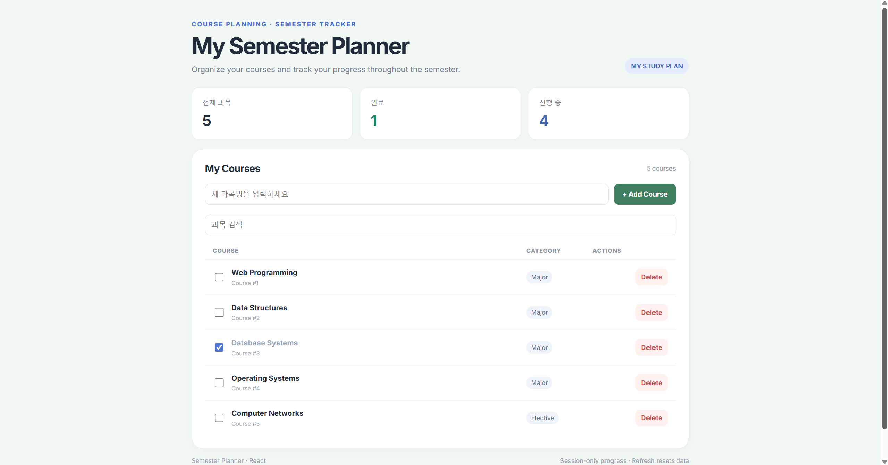

# My Semester Planner

과목을 등록하고, 완료한 과목을 표시할 수 있는 React 과목 관리 앱입니다.

- 원본 프로젝트: https://github.com/2026-2-OSS/week11_sample_project
- GitHub 저장소: https://github.com/Jin030121/assign11-c01-22500616
- 배포 주소: https://assign11-c01-22500616.vercel.app

## 주요 기능

- 과목 목록 보기 및 삭제
- 새 과목 등록
- 과목 완료 여부 표시
- 과목명 검색
- 전체 과목과 완료한 과목 수 확인

과목 목록은 앱을 실행하는 동안에만 저장됩니다. 새로고침하면 처음 과목 목록으로 돌아갑니다.

## 설치 및 실행

```bash
git clone https://github.com/Jin030121/assign11-c01-22500616.git
cd assign11-c01-22500616
npm install
npm run dev
```

실행 후 터미널에 표시되는 주소를 브라우저에서 열면 됩니다. 빌드 확인은 `npm run build` 명령으로 할 수 있습니다.

## 실행 화면



배포된 사이트: https://assign11-c01-22500616.vercel.app

## 소스 코드 살펴보기

### 주요 파일

- `src/main.jsx`: 앱을 시작하는 파일입니다.
- `src/App.jsx`: 화면 제목과 전체 구성을 보여줍니다.
- `src/components/CourseList.jsx`: 과목 등록, 삭제, 완료 변경, 검색을 처리합니다.
- `src/components/CourseItem.jsx`: 과목 하나와 체크박스, 삭제 버튼을 보여줍니다.
- `src/data/courses.js`: 처음 보여줄 과목 목록이 있습니다.
- `src/App.css`: 화면 디자인을 정합니다.

### 컴포넌트와 Props

`App`이 `CourseList`를 보여줍니다. `CourseList`는 과목마다 `CourseItem`을 만들고, 과목 정보와 삭제·완료 변경 함수를 Props로 전달합니다.

체크박스나 삭제 버튼을 누르면 `CourseItem`이 전달받은 함수를 실행합니다. 실제 과목 목록은 `CourseList`에서 바뀝니다.

### State와 이벤트

`CourseList`는 `useState`로 과목 목록, 입력값, 검색어 등을 관리합니다. 입력이나 버튼 클릭으로 State가 바뀌면 화면도 다시 표시됩니다.

과목을 삭제하거나 검색할 때는 `filter()`를 사용하고, 완료 상태를 바꿀 때는 `map()`을 사용합니다.

### 코드 1: 과목 등록

입력값이 비어 있으면 등록하지 않습니다. 이름을 입력하면 새 과목을 목록에 추가하고 입력 칸을 비웁니다.

```jsx
function handleAdd(event) {
  event.preventDefault();
  const trimmedName = newName.trim();
  if (!trimmedName) {
    setErrorMessage('과목명을 입력하세요.');
    return;
  }
  const newCourse = { id: nextId, name: trimmedName, category: 'Elective', completed: false };
  setCourses(previous => [...previous, newCourse]);
  setNextId(previousId => previousId + 1);
  setNewName('');
  setErrorMessage('');
}
```

### 코드 2: 완료 상태 변경

체크박스를 누르면 선택한 과목의 완료 상태가 반대로 바뀝니다.

```jsx
function handleToggle(id) {
  setCourses(previous =>
    previous.map(course =>
      course.id === id
        ? { ...course, completed: !course.completed }
        : course
    )
  );
}
```

## 수정한 내용

- `src/data/courses.js`: 처음 나오는 과목 5개를 변경했습니다.
- `src/App.jsx`: 제목과 설명을 “My Semester Planner”에 맞게 바꿨습니다.
- `src/App.css`: 배경색과 Add 버튼 색을 바꾸고 과목 목록 모서리를 더 둥글게 했습니다. CSS 코드도 읽기 쉽게 정리했습니다.

## 추가한 기능

- **과목 등록:** 과목명을 입력하고 Add Course를 누르면 목록에 추가됩니다. 빈 이름은 등록되지 않습니다.
- **완료 표시:** 체크박스를 누르면 완료 여부가 바뀌고, 완료한 과목에는 취소선이 생깁니다.
- **과목 검색:** 검색 칸에 입력한 글자가 들어간 과목만 볼 수 있습니다.

## 배포

- Vercel: https://assign11-c01-22500616.vercel.app
- GitHub Classroom: https://github.com/2026-2-OSS/assign11-c01-22500616
- 개인 GitHub: https://github.com/Jin030121/assign11-c01-22500616

## Weekly Review

### 새롭게 배운 내용

1. 컴포넌트끼리 Props로 정보와 함수를 전달할 수 있다는 것을 배웠습니다.
2. `useState`로 값을 바꾸면 화면도 함께 바뀐다는 것을 배웠습니다.
3. `map()`과 `filter()`로 과목 목록을 바꾸거나 검색할 수 있다는 것을 배웠습니다.

### 어려웠던 점과 해결 방법

완료 체크박스를 만들 때 선택한 과목의 상태만 바꾸는 방법이 헷갈렸습니다. `map()`으로 과목 목록을 확인하고, 선택한 과목만 새 객체로 바꾼 뒤 `setCourses()`로 저장했습니다. 이렇게 하니 화면의 완료 표시도 바로 바뀌었습니다.

### AI 활용 내용과 느낀 점

AI에게 코드와 기능에 대해 질문하고 설명을 받았습니다. 설명을 보며 과목 등록, 완료 표시, 검색 기능이 코드에서 어떻게 동작하는지 확인했습니다. 모르는 코드를 물어보고 실제 화면에서 확인하는 것이 이해하는 데 도움이 됐습니다.
